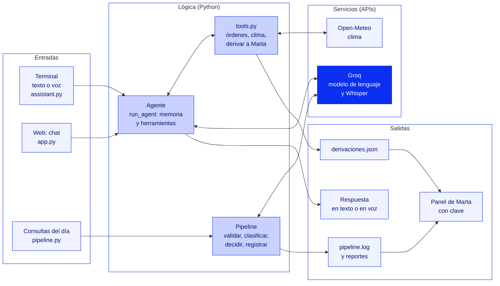

# Rayo, el asistente virtual de Rodados Sur

Rodados Sur es una tienda y taller de bicicletas de barrio. Todos los días recibe las mismas preguntas: horarios, precios, el estado de una reparación, si conviene salir a rodar. Rayo las responde solo, por texto o por voz, y le pasa a Marta (la dueña) lo que no sabe o es urgente.

Proyecto Integrador del curso "Python con IA: Desarrollo de Agentes y Aplicaciones Inteligentes" (Educación IT).

## Qué hace

- **Conversa y recuerda:** responde con un modelo de lenguaje y recuerda lo que el cliente dijo antes en la conversación.
- **Usa herramientas:** consulta el estado de una orden del taller (`ordenes.json`) y el clima del día (Open-Meteo).
- **Deriva a Marta:** si no tiene la respuesta o el caso es urgente, pide un nombre y un teléfono y deja la consulta en `derivaciones.json`. Si algo falla, responde con los datos del local y también deriva.
- **Escucha y habla:** en la terminal, entiende la voz (Whisper) y responde en voz alta (pyttsx3).
- **Procesa las consultas del día:** un pipeline clasifica en lote los mensajes de WhatsApp y de la web, con registro, tiempos y metadatos.
- **Funciona en la web:** un chat para los clientes y un panel con clave para Marta (Streamlit).

## Tecnologías

| Pieza | Tecnología |
|---|---|
| Lenguaje | Python (probado con 3.9, 3.11 y 3.13) |
| Modelo de lenguaje | Groq (`openai/gpt-oss-20b`), con la API compatible con OpenAI; Ollama como alternativa local |
| Voz | Whisper en Groq (voz a texto), pyttsx3 y gTTS (texto a voz), SpeechRecognition (micrófono) |
| Datos externos | Open-Meteo (clima), con `requests` |
| Interfaz web | Streamlit |
| Configuración | Variables de entorno en `.env` con `python-dotenv` |
| Publicación | GitHub y Streamlit Community Cloud |

## Arquitectura



| Archivo | Qué hace |
|---|---|
| `assistant.py` | El agente: instrucciones, memoria y bucle de herramientas (`run_agent`). Se ejecuta en la terminal, por texto o por voz |
| `llm_client.py` | Habla con el modelo de lenguaje (Groq u Ollama) y valida las respuestas en JSON |
| `tools.py` | Las herramientas del agente: órdenes, clima y derivación a Marta |
| `weather.py` | Consulta el clima en Open-Meteo |
| `speech_input.py` y `speech_output.py` | Voz a texto y texto a voz |
| `pipeline.py` | Procesa en lote las consultas del día |
| `app.py` | La interfaz web: el chat y el panel de Marta. Solo se ocupa de la pantalla |
| `ordenes.json` y `consultas_del_dia.json` | Datos de ejemplo |

## Cómo funciona una consulta

1. El cliente escribe (en la web o en la terminal) o habla (en la terminal: Whisper convierte la voz en texto).
2. La interfaz valida el mensaje: no puede estar vacío y tiene un máximo de 500 caracteres.
3. El agente envía la conversación completa al modelo, con las instrucciones del negocio.
4. Si el modelo necesita un dato, pide una herramienta: el estado de una orden, el clima o derivar a Marta. Python la ejecuta y le devuelve el resultado.
5. El modelo escribe la respuesta, que se muestra en pantalla (y en la terminal, en modo voz, también se escucha).
6. Si algo falla (sin internet, límite del plan, clave inválida), el cliente recibe una respuesta alternativa con los datos del local, el error queda en el registro y la consulta pasa a Marta.

## Cómo ejecutarlo

1. Crear y activar el entorno virtual, e instalar las librerías:

   ```powershell
   python -m venv .venv
   .venv\Scripts\Activate.ps1
   python -m pip install -r requirements.txt
   ```

2. Crear el archivo `.env` (a partir de `.env.example`) con estas variables:

   | Variable | Para qué |
   |---|---|
   | `GROQ_API_KEY` | La clave de Groq (gratis en console.groq.com) |
   | `ASSISTANT_NAME` | El nombre del asistente |
   | `WEATHER_LATITUDE` y `WEATHER_LONGITUDE` | Dónde está el local, para el clima |
   | `MARTA_PASSWORD` | La clave del panel de Marta en la web |
   | `GROQ_MODEL` (opcional) | Otro modelo de Groq |

3. Ejecutar:

   ```powershell
   python assistant.py                # el agente en la terminal (texto o voz)
   python pipeline.py                 # las consultas del día
   python -m streamlit run app.py     # la app web, en http://localhost:8501
   ```

**En la nube:** el código va a un repositorio de GitHub (sin el `.env`) y Streamlit Community Cloud lo ejecuta. Las variables del `.env` se cargan en **Secrets**.

## Reflexión técnica

**Qué se puede escalar:**
- El modelo: cambiar de proveedor o de modelo es cambiar una variable de entorno; el resto del código no se entera.
- Los canales: el agente no sabe si la consulta llega por la terminal, la web o un lote. Mañana puede llegar por WhatsApp.
- Las herramientas: una función nueva y su descripción, sin tocar el bucle del agente.

**Qué mejoraría:**
- Guardar las derivaciones y las conversaciones en una base de datos: en la nube, los archivos se borran cuando la app se reinicia.
- Un acceso con usuario para Marta, en lugar de una sola clave.
- Un plan pago o una cola de consultas para no chocar con el límite por minuto del plan gratuito.
- Voz también en la web.
- Que Marta pueda marcar una derivación como resuelta.
